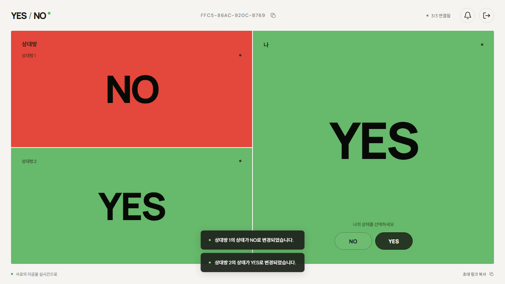

# YES / NO

처음 배포한다면 [한 단계씩 따라 하는 한국어 설명서](처음부터_배포하기_설명서.md)부터 읽으세요.

아이패드와 노트북에서 한 방에 최대 20명이 YES 또는 NO를 서로 전달하는 웹 앱입니다. 오른쪽은 **나**, 왼쪽은 **상대방**입니다. 3명이 참여하면 왼쪽을 위아래로 나누고, 4명 이상이면 왼쪽 목록을 스크롤해 모든 상대의 상태를 볼 수 있습니다. 각자 오른쪽 위 연필 버튼으로 자신의 이름을 바꿀 수 있습니다. 이름을 바꾸면 `#2 민지`처럼 현재 방에 남은 사람 기준 입장 순서와 이름만 표시됩니다.

프런트엔드는 **React + TypeScript + Vite**, 실시간 서버는 **Cloudflare Workers + Durable Objects**로 구현했습니다. 웹 화면은 GitHub Pages에 게시할 수 있습니다. 배포 후에는 각 기기에서 인터넷 주소만 열면 되며, 노트북에서 서버를 실행할 필요가 없습니다.



[시작 화면](docs/lobby-desktop.png) · [아이패드 세로 화면](docs/room-ipad-portrait.png)

## 구현한 기능

- 초대 링크·숫자 4자리 방 코드로 참여, 모바일 코드 입력창은 숫자 키패드를 요청, 서버에서 최대 20명으로 제한
- 선택 사항인 이름 변경: 기본 표시는 `#번호 나` / `#번호 상대방`, 변경 후에는 `#번호 이름`만 표시. 번호는 현재 방에 남은 사람의 입장 순서로 다시 매겨짐. 이름은 16자 이내이며 같은 방에서 중복할 수 없음
- 초록색 YES / 빨간색 NO, 모든 기기에서 오른쪽 내 상태 / 왼쪽 상대방 상태 유지
- 참여자별 독립 상태, WebSocket 실시간 전달, 변경 시 화면 알림
- 새로고침·네트워크 복구 후 10분 안에는 같은 자리로 재접속, 마지막 선택 복원
- 다른 탭에서 같은 방을 열면 기존 탭에 안내하고 새 탭으로 연결 이동
- 참여자별 연결 끊김 표시, 연결이 끊긴 상태에서는 선택 전송 차단
- 왼쪽 상대방 목록에서 YES/NO가 바뀐 사람은 맨 위로, 연결 끊김이 10초 이어진 사람은 맨 아래로 한 번 이동. 재연결만으로는 맨 위로 이동하지 않음
- 나가기 시 즉시 자리 비우기, 연결 끊김이 10분 지속되면 자동 퇴장, 방에 활동이 없으면 24시간 후 만료
- PWA 홈 화면 아이콘, 서비스 워커, 권한 기반 Web Push 발송
- GitHub Pages·Cloudflare 배포 워크플로, 자동 검사 및 브라우저 테스트

## 먼저 알아둘 점

코드와 로컬 검증까지 준비된 프로젝트입니다. 실제 인터넷 송수신에는 **Cloudflare 서버 배포와 GitHub Pages 설정**이 필요합니다. GitHub에 파일만 올리는 것으로 실시간 서버가 실행되지는 않습니다.

시스템 알림은 VAPID 키를 설정한 배포 환경에서 사용할 수 있습니다. 화면 안 알림은 키 없이 작동합니다. iPadOS 16.4 이상에서는 Safari의 **공유 → 홈 화면에 추가** 후 홈 화면의 앱에서 알림을 허용해야 백그라운드 푸시를 사용할 수 있습니다. 알림 권한·집중 모드·기기 네트워크에 따라 도착 여부와 시점이 달라집니다. 실제 아이패드의 시스템 알림 수신은 배포 후 확인해야 합니다.

## 개발 환경 실행

Node.js 22.12 이상을 사용합니다. 자동 검증은 Node.js 24 기준입니다.

```sh
npm ci
npm run dev
```

브라우저에서 `http://127.0.0.1:5173`을 엽니다. 개발 명령은 화면과 Cloudflare 서버 에뮬레이터를 함께 실행합니다. 외부 계정 없이 개발·테스트할 수 있습니다. 이 로컬 서버는 개발 도구이며, 실제 사용은 아래의 인터넷 배포 방식입니다.

다른 참여자를 시험하려면 시크릿 창이나 다른 브라우저 프로필을 사용하세요. 같은 브라우저 프로필의 다른 탭은 동일한 참여자로 인식합니다.

## GitHub와 Cloudflare에 배포

### 1. 코드를 GitHub 저장소에 올리기

이 폴더의 소스 코드와 `package-lock.json`을 저장소에 올립니다. `.gitignore`가 제외하는 `node_modules`, `.wrangler`, `.env`, `.dev.vars`는 올리지 않습니다. 기본 브랜치는 `main`을 기준으로 설정했습니다.

### 2. 실시간 서버 배포

Cloudflare 계정을 준비한 다음 로그인합니다.

```sh
npx wrangler login
```

`worker/wrangler.jsonc`의 `ALLOWED_ORIGINS`를 웹 화면이 게시될 **출처(origin)**로 바꿉니다. 경로와 마지막 `/`를 포함하지 않습니다. 예를 들어 Pages 주소가 `https://myname.github.io/yes-no/`이면 아래처럼 설정합니다.

```json
"vars": {
  "ALLOWED_ORIGINS": "https://myname.github.io"
}
```

개발 주소도 계속 허용하려면 쉼표로 추가합니다. 배포한 뒤 표시되는 `https://yes-no-together-api.<계정>.workers.dev` 주소를 기록합니다.

```sh
npm run deploy:api
```

이 설정은 SQLite 기반 Durable Object를 생성합니다. 사용 가능 한도와 비용은 계정의 Cloudflare 요금제를 따릅니다. 배포 스크립트가 별도로 유료 플랜을 신청하지는 않습니다.

### 3. GitHub Pages 설정

저장소의 **Settings → Secrets and variables → Actions → Variables**에 다음 값을 추가합니다.

- `VITE_API_URL`: 위에서 배포한 Worker의 HTTPS 주소. 마지막 `/`는 생략합니다.
- `VITE_BASE_PATH`: 기본값은 `/저장소이름/`입니다. `username.github.io` 저장소나 루트 사용자 지정 도메인이라면 `/`로 설정합니다.

**Settings → Pages → Build and deployment → Source**에서 **GitHub Actions**를 선택합니다. **Actions → Deploy web to GitHub Pages → Run workflow**로 게시합니다. 이후 `main`에 소스를 올리면 웹 화면이 갱신됩니다. 서버 주소를 설정하기 전 Pages 배포는 누락된 설정을 안내하며 중단됩니다.

### 4. 선택: GitHub Actions에서 서버도 배포

저장소의 Actions **Secrets**에 `CLOUDFLARE_API_TOKEN`, `CLOUDFLARE_ACCOUNT_ID`를 설정하고, **Variables**에 `ALLOWED_ORIGINS`를 설정합니다. API 토큰에는 해당 계정의 Worker 배포에 필요한 권한을 부여합니다.

**Actions → Deploy realtime API → Run workflow**로 실행할 수 있습니다. 이 워크플로는 수동 실행 방식입니다. 웹 화면의 서버 주소가 달라지면 `VITE_API_URL`도 변경하고 화면을 다시 배포합니다.

## 시스템 알림 설정

1. `npm run push:keys`로 공개 키와 비밀 키를 생성합니다. 생성된 값은 GitHub 코드에 넣지 않습니다.
2. 아래 명령으로 각 값을 Worker secret에 저장합니다. 각 명령이 입력을 요청하면 해당 값을 붙여 넣습니다.

```sh
npx wrangler secret put VAPID_PUBLIC_KEY --config worker/wrangler.jsonc
npx wrangler secret put VAPID_PRIVATE_KEY --config worker/wrangler.jsonc
npx wrangler secret put VAPID_SUBJECT --config worker/wrangler.jsonc
```

`VAPID_SUBJECT`에는 운영자가 확인할 수 있는 연락처를 `mailto:실제주소@example.com` 형식으로 입력합니다. 키를 교체하면 기존 브라우저 푸시 구독을 해제하고 새 키로 다시 등록해야 합니다.

3. HTTPS 웹 앱에서 방에 입장한 뒤 우측 상단 종 아이콘을 눌러 알림을 허용합니다.
4. 아이패드는 홈 화면에 추가한 앱에서 실행합니다. 상대방이 상태를 바꾸면, 앱이 보이는 동안은 화면 알림을 띄우고 앱이 숨겨졌거나 연결이 끊긴 동안은 시스템 푸시를 발송합니다.

종 아이콘으로 시스템 알림을 끌 수 있습니다. 같은 선택을 다시 누르거나 재연결 시 동기화된 상태에는 새 알림을 발송하지 않습니다. 처음 `선택 전`에서 YES/NO를 선택한 경우에도 변경 사실을 알립니다.

## 연결 상태와 데이터 처리

- 정상적인 창 닫기는 연결 끊김을 빠르게 전달합니다. 갑작스러운 네트워크 단절은 5초 간격 점검과 25초 응답 제한으로 **최대 약 30초 후** 다른 참여자에게 표시됩니다.
- 아이패드가 잠들거나 브라우저가 백그라운드에서 일시 중지되면 실시간 연결이 끊긴 것으로 표시될 수 있습니다. 10분 안에 화면을 다시 열면 같은 자리로 복구합니다.
- 서버가 연결 끊김을 확인한 뒤 10분 동안 재접속하지 않으면 그 사람을 자동으로 퇴장시키고 자리를 비웁니다. 그 뒤 다시 들어오면 새 참여자로 등록되므로 이전 이름·YES/NO·입장 번호는 복원되지 않습니다. 퇴장할 때 푸시 등록도 제거됩니다. **방 나가기**를 누르면 즉시 자리가 비워집니다.
- 참여자 식별용 무작위 비밀값은 해당 브라우저 저장소에 보관하고 WebSocket 연결 후 전송합니다. 초대 링크에는 개인 식별 비밀값이 포함되지 않습니다.
- 서버에는 현재 선택·참여자 자리·선택한 이름·접속용 비밀값·선택한 경우 푸시 구독만 저장합니다. 선택 변경 기록과 사용자 계정은 저장하지 않습니다.
- 방 코드를 가진 사람은 빈 자리에 참여할 수 있습니다. **숫자 4자리는 쉽게 추측할 수 있으므로 비공개 대화나 민감한 정보를 다루는 방으로 사용하지 마세요.** 브라우저 데이터를 삭제하면 기존 자리의 재접속 정보도 사라집니다.
- 서버는 동시 입장 요청에도 정원을 검사하고, 인증된 연결의 본인 상태만 변경합니다. 푸시 주소는 알려진 브라우저 푸시 서비스만 허용합니다.

## 검증 명령

```sh
npm run build
npm test
npx playwright install chromium
npm run test:e2e
```

단위 검사는 20명 제한·이름 변경·상대방 정렬·재접속·독립 상태·중복 변경·푸시 주소 검증을 다룹니다. 브라우저 검사는 실제 로컬 Worker와 연결해 동시 입장·21번째 접속 차단·양방향 변경·이름 변경·10초 후 연결 끊김 정렬·재접속·자리 비우기·응답 없는 연결의 시간 초과를 확인합니다. 아이패드 화면 크기는 브라우저에서 재현하며, 실물 iPad Safari 및 운영 환경의 푸시 수신 검증을 대체하지 않습니다.

## 주요 파일

- `src/main.tsx`: 시작 화면, 2분할 상태 화면, 초대·알림·나가기
- `src/connection.ts`: 연결·재연결, 참여자 식별, 이벤트 수신
- `src/styles.css`: 반응형 디자인
- `worker/index.ts`: 방 생성, WebSocket, 접속 감지, 푸시 발송
- `worker/state.ts`: 정원과 참여자별 상태 관리
- `public/sw.js`, `public/manifest.webmanifest`: PWA와 푸시 알림
- `.github/workflows/`: 검사와 배포 자동화

## 참고 문서

- [Cloudflare Durable Object WebSocket](https://developers.cloudflare.com/durable-objects/examples/websocket-hibernation-server/)
- [Cloudflare Durable Object SQLite 설정](https://developers.cloudflare.com/durable-objects/reference/durable-objects-migrations/)
- [GitHub Pages 생성](https://docs.github.com/en/pages/getting-started-with-github-pages/creating-a-github-pages-site)
- [iPadOS 홈 화면 앱의 Web Push](https://webkit.org/blog/13878/)
- [Web Crypto 기반 푸시 라이브러리](https://github.com/block65/webcrypto-web-push/tree/master/packages/web-push)
